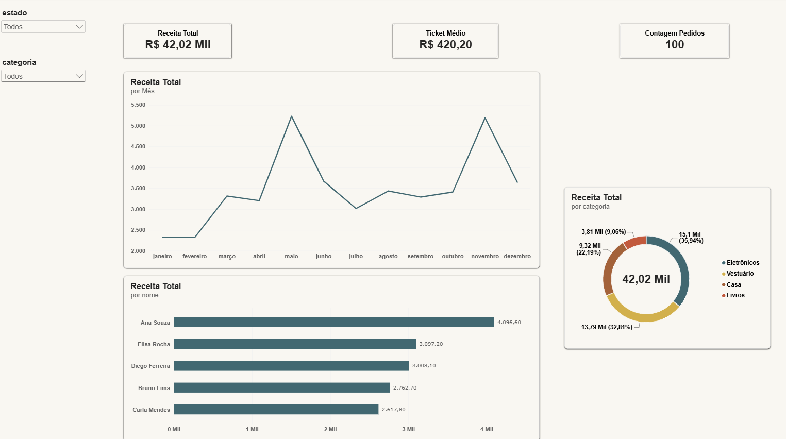

# Dashboard Executivo de E-commerce - Power BI

## Contexto de Negócio
Este projeto tem como objetivo transformar dados brutos de vendas de um e-commerce em um dashboard executivo interativo, permitindo que a diretoria acompanhe a saúde financeira do negócio em tempo real.

## Ferramentas e Técnicas Utilizadas
- **Power BI Desktop**: Criação de relatórios e visualizações.
- **Modelagem de Dados**: Conexão direta com o banco de dados PostgreSQL, criação de relacionamentos (Star Schema) entre as tabelas `clientes`, `produtos`, `pedidos` e `itens_pedido`.
- **DAX (Data Analysis Expressions)**: Criação de medidas como `Receita Total` (usando SUMX) e `Ticket Médio` (usando DISTINCTCOUNT).
- **Power Query**: Tratamento e limpeza dos dados.

## Estrutura do Repositório
- `dashboard_ecommerce.pbix`: Arquivo do relatório no Power BI.
- `imagens/`: Prints do dashboard final.

## Principais Insights
- **Faturamento Total:** R$ 42,02 Mil no período.
- **Ticket Médio:** R$ 420,20 por pedido.
- **Sazonalidade:** Picos claros de venda nos meses de Maio e Novembro.
- **Mix de Produtos:** Eletrônicos e Vestuário juntos representam quase 70% do faturamento.
- **Categorias:** A cliente Ana Souza é a principal compradora, o que sugere a necessidade de estratégias de retenção (CRM).

## Visualização do Dashboard
.

## Como Reproduzir
1. Baixe o arquivo `.pbix` e abra no Power BI Desktop.
2. Para atualizar os dados, é necessário ter o banco PostgreSQL `ecommerce.db` configurado na máquina local.
